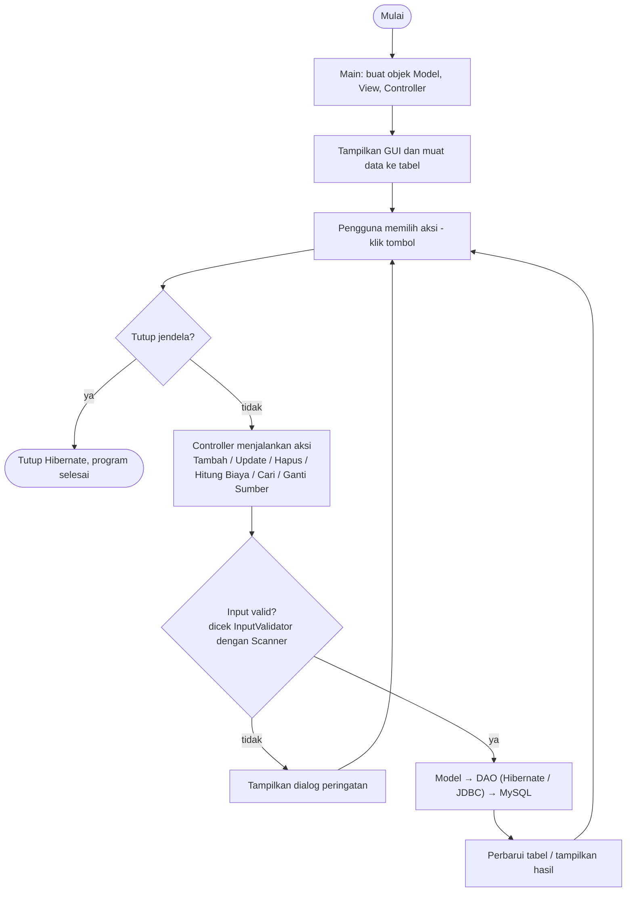
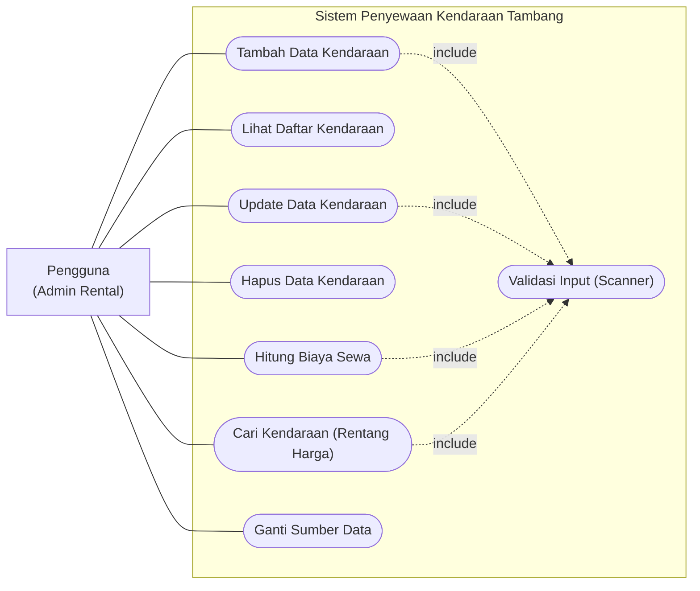

# Project-Akhir-PBO-penyewaaan-kendaraan-tambang
# Sistem Penyewaan Kendaraan Tambang

Aplikasi desktop **Java Swing** untuk mengelola data dan menghitung biaya sewa kendaraan tambang (**Dump Truck** dan **Excavator**), terhubung ke **MySQL** melalui **JDBC** dan **Hibernate ORM**.

---

## 1. Nama Program

**Sistem Penyewaan Kendaraan Tambang** (nama proyek NetBeans: `SewaKendaraanTambang`)

## 2. Deskripsi Singkat Program

Aplikasi desktop berbasis Java Swing untuk mengelola data dan menghitung biaya sewa kendaraan tambang jenis **Dump Truck** dan **Excavator**. Data disimpan di database MySQL dan dapat diakses dengan dua cara: JDBC (PreparedStatement + DAO) atau framework ORM Hibernate.

Program ini merupakan lanjutan dari versi konsol sebelumnya. Seluruh materi lama tetap dipertahankan: percabangan, perulangan, validasi input dengan Scanner, 4 pilar OOP, pola MVC, serta JDBC dan DAO.

## 3. Fitur Utama Program

| Fitur | Keterangan |
| --- | --- |
| Tambah data kendaraan | Input jenis (Dump Truck / Excavator), ID, nama, harga sewa per hari, dan kapasitas. ID tidak boleh duplikat. |
| Tampilkan semua kendaraan | Data ditampilkan dalam tabel (ID, jenis, nama, harga sewa/hari, detail kapasitas). |
| Update data kendaraan | Pilih baris tabel, lalu ubah nama, harga, atau kapasitas. ID dan jenis dikunci. |
| Hapus data kendaraan | Pilih baris tabel, lalu konfirmasi sebelum data dihapus. |
| Hitung biaya sewa | Lama sewa 1–365 hari dan diskon 0–100%. Dump Truck mendapat potongan 10% untuk sewa ≥ 7 hari. Excavator mendapat potongan 5% untuk ≥ 7 hari dan 15% untuk ≥ 30 hari. |
| Cari berdasarkan rentang harga | Menampilkan kendaraan dengan harga sewa per hari di antara harga minimum dan maksimum. |
| Pilih sumber data | Beralih antara Hibernate ORM dan JDBC (PreparedStatement) tanpa menutup aplikasi. |
| Validasi input | Input kosong, bukan angka, atau di luar rentang ditolak dengan pesan peringatan. |

## 4. Tech Stack

| Komponen | Teknologi | Kegunaan |
| --- | --- | --- |
| Bahasa | Java 17 | Bahasa pemrograman utama |
| IDE | Apache NetBeans | Penulisan, build, dan menjalankan program |
| Build tool | Apache Maven | Mengelola library (dependency) dan proses build |
| GUI | Java Swing (tema Nimbus) | Tampilan antarmuka pengguna |
| Database | MySQL (via XAMPP) | Penyimpanan data kendaraan |
| Akses data 1 | JDBC + PreparedStatement | Query SQL manual yang aman dari SQL injection |
| Akses data 2 (ORM) | Hibernate ORM 6.4.4 (Jakarta Persistence) | Memetakan class Java ke tabel tanpa SQL manual |
| Driver | MySQL Connector/J 8.3.0 | Penghubung Java ke MySQL |
| Version control | Git + GitHub | Penyimpanan dan berbagi kode |

## 5. Perancangan Sistem

### Flowchart

Program berjalan dalam satu loop: GUI menunggu aksi pengguna, memvalidasi input, lalu memproses data lewat DAO ke MySQL sampai jendela ditutup.



### Use Case Diagram

Satu aktor (Pengguna) memakai tujuh use case. Tambah, Update, Hitung Biaya, dan Cari selalu menyertakan (*include*) Validasi Input sebelum diproses.



## 6. Struktur Folder / Package

Proyek memakai struktur standar Maven dengan 6 package yang mengikuti pola MVC.

```
SewaKendaraanTambang
├── pom.xml
├── database.sql
├── README.md
├── docs
│   └── screenshots          ← gambar untuk README
└── src/main
    ├── java
    │   ├── main
    │   │   └── Main.java
    │   ├── model
    │   │   ├── KendaraanTambang.java
    │   │   ├── DumpTruck.java
    │   │   ├── Excavator.java
    │   │   └── PengelolaKendaraan.java
    │   ├── view
    │   │   └── KendaraanView.java
    │   ├── controller
    │   │   └── KendaraanController.java
    │   ├── dao
    │   │   ├── KendaraanDAO.java
    │   │   ├── KendaraanDAOImpl.java
    │   │   └── KendaraanDAOHibernate.java
    │   └── util
    │       ├── KoneksiDB.java
    │       ├── HibernateUtil.java
    │       └── InputValidator.java
    └── resources
        └── hibernate.cfg.xml
```

| Package / File | Peran |
| --- | --- |
| `main` | Titik awal program; membuat Model, View, dan Controller |
| `model` | Class entitas kendaraan (juga entity Hibernate) dan pengelola logika data |
| `view` | Tampilan Java Swing: form, tabel, tombol, dialog pesan |
| `controller` | Menangani event tombol, validasi input, dan menghubungkan View dengan Model |
| `dao` | Interface DAO dan dua implementasinya: JDBC dan Hibernate |
| `util` | Koneksi JDBC, SessionFactory Hibernate, dan validasi input dengan Scanner |
| `hibernate.cfg.xml` | Konfigurasi koneksi dan daftar entity Hibernate |
| `pom.xml` | Daftar library Maven (Hibernate, MySQL Connector) |
| `database.sql` | Script pembuatan database, tabel, dan data dummy awal |

## 7. Penerapan 4 Pilar OOP

Keempat pilar diterapkan terutama di package `model` dan `dao`, lalu dimanfaatkan oleh `controller` dan `view`.

### Encapsulation

Atribut disembunyikan dengan `private` dan hanya bisa diakses lewat getter/setter. Setter sekaligus memvalidasi data sehingga objek tidak pernah berisi nilai yang salah.

- `KendaraanTambang`: atribut `id`, `namaKendaraan`, dan `hargaSewaPerHari` bersifat private. `setHargaSewaPerHari()` menolak harga ≤ 0, dan `setNamaKendaraan()` menolak nama kosong.
- `DumpTruck.kapasitasTon` dan `Excavator.kapasitasBucket` bersifat private dengan setter yang menolak nilai ≤ 0.
- `KendaraanView`: semua komponen Swing bersifat private; Controller hanya membaca input lewat getter seperti `getInputHarga()`.

```java
private double hargaSewaPerHari;

public void setHargaSewaPerHari(double hargaSewaPerHari) {
    if (hargaSewaPerHari <= 0) {
        throw new IllegalArgumentException("Harga sewa harus lebih dari 0.");
    }
    this.hargaSewaPerHari = hargaSewaPerHari;
}
```

### Inheritance

`DumpTruck` dan `Excavator` mewarisi `KendaraanTambang` dengan `extends`. Keduanya memakai ulang atribut, getter/setter, `validasiHari()`, dan `toString()` milik class induk, lalu menambahkan atribut kapasitasnya sendiri. Di sisi ORM, pewarisan ini dipetakan Hibernate dengan `@Inheritance(strategy = InheritanceType.SINGLE_TABLE)`.

```java
@Entity
@DiscriminatorValue("Dump Truck")
public class DumpTruck extends KendaraanTambang { ... }
```

### Polymorphism

- **Overriding:** `hitungBiayaSewa(int hari)`, `getJenis()`, `getDetail()`, dan `getKapasitas()` ditulis ulang di `DumpTruck` dan `Excavator` dengan perilaku berbeda (aturan potongan harga berbeda per jenis).
- **Overloading:** `hitungBiayaSewa(int hari)` dan `hitungBiayaSewa(int hari, double diskonPersen)` di `KendaraanTambang`; `cari(String id)` dan `cari(double hargaMin, double hargaMax)` di `PengelolaKendaraan`.
- **Referensi induk ke objek anak:** di `KendaraanController.tambahData()`, variabel bertipe `KendaraanTambang` diisi objek `DumpTruck` atau `Excavator`. Tabel di `KendaraanView` memanggil `k.getJenis()` dan `k.getDetail()` tanpa perlu tahu jenis aslinya.
- **Polymorphism lewat interface:** `PengelolaKendaraan` menyimpan `KendaraanDAO`, yang bisa diisi `KendaraanDAOImpl` (JDBC) atau `KendaraanDAOHibernate` (ORM) saat program berjalan.

```java
KendaraanTambang kendaraan;
if (jenis == KendaraanView.JENIS_DUMP_TRUCK) {
    kendaraan = new DumpTruck(id, nama, harga, kapasitas);
} else {
    kendaraan = new Excavator(id, nama, harga, kapasitas);
}
```

### Abstraction

- `KendaraanTambang` adalah `abstract class` sehingga objeknya tidak bisa dibuat langsung. Class ini mendeklarasikan method abstract `getJenis()`, `getDetail()`, `getKapasitas()`, `setKapasitas()`, dan `hitungBiayaSewa(int hari)` yang wajib diisi subclass.
- Interface `KendaraanDAO` hanya mendefinisikan operasi `insert`, `getAll`, `getById`, `getByRentangHarga`, `update`, dan `delete`. Cara kerjanya (SQL manual atau Hibernate) disembunyikan di class implementasinya.

```java
public abstract class KendaraanTambang {
    public abstract String getJenis();
    public abstract double hitungBiayaSewa(int hari);
}
```
